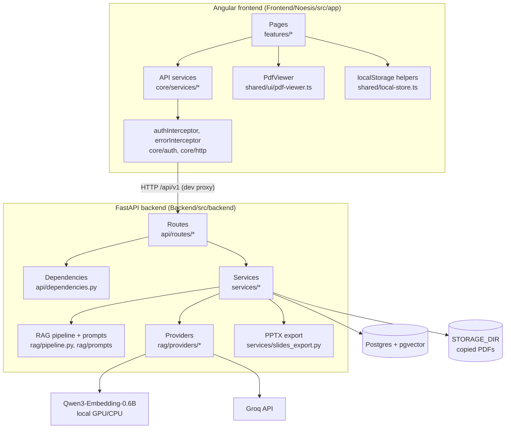
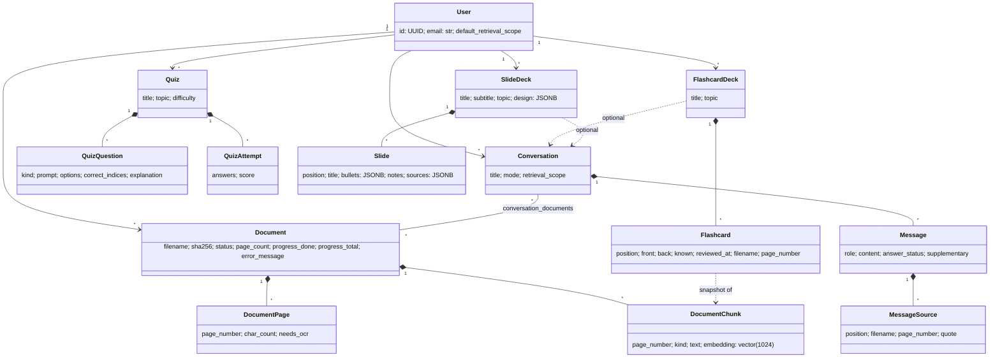
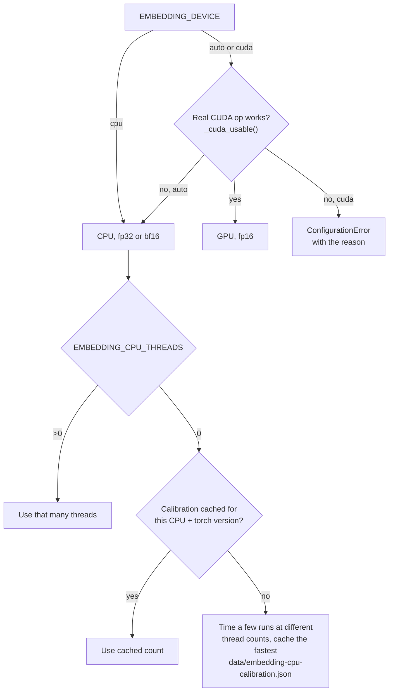
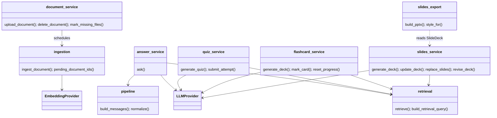
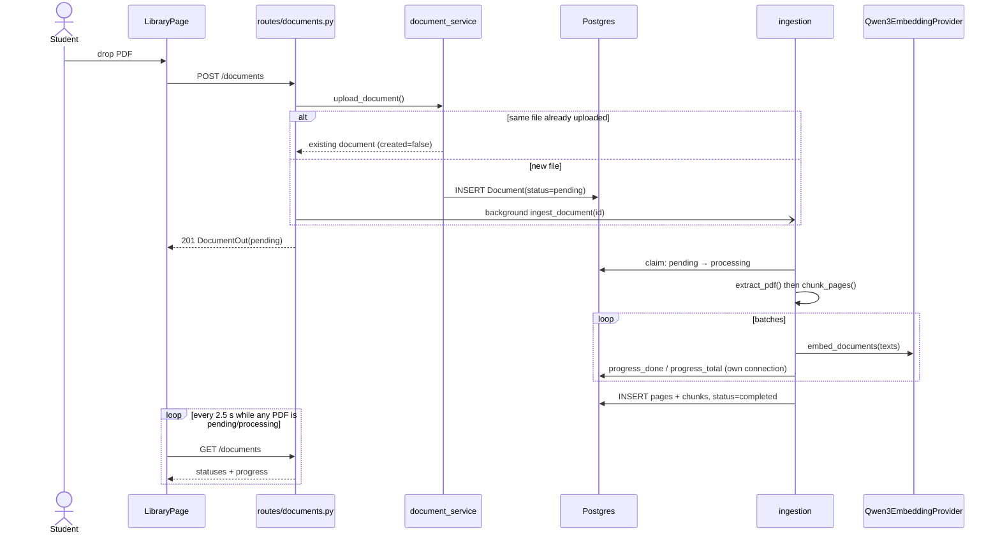
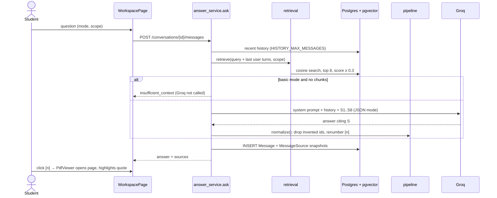
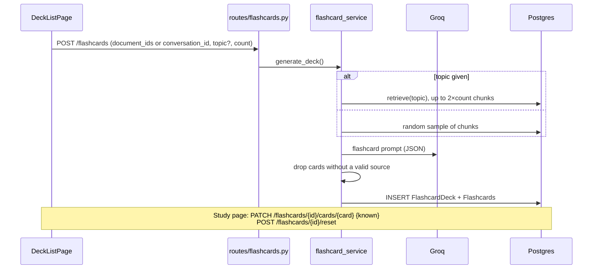
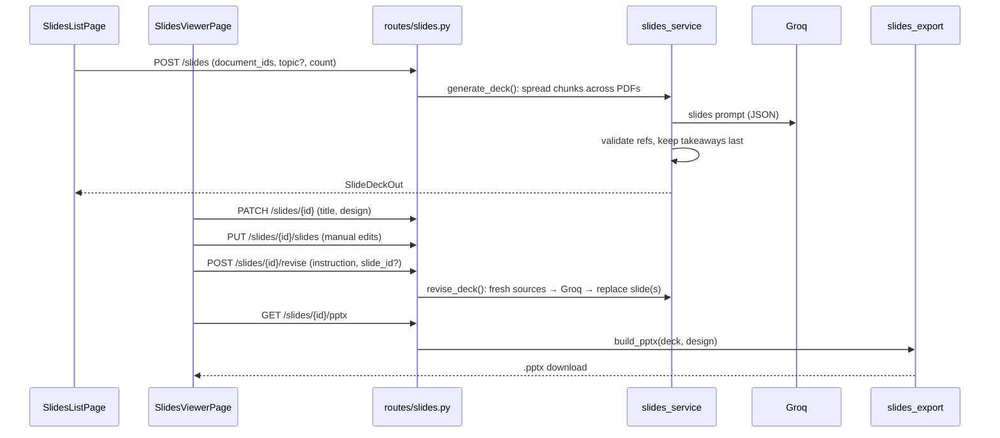
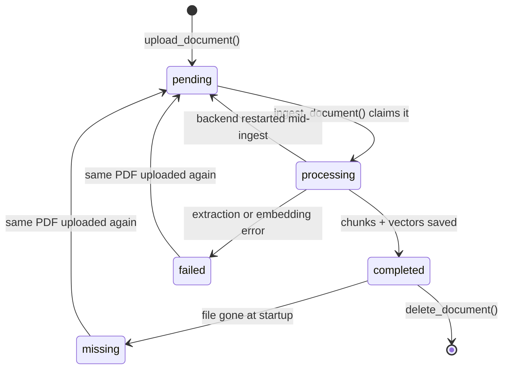
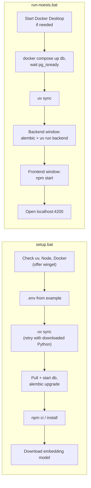

# Noesis architecture

Nov 22, 2026 · @coconut. This updates *Noesis architecture.docx* (Nov 12) with Flashcards, Slides, ingestion progress, the retrieval threshold, embedding device and CPU tuning, and the Windows scripts.

## Overview

Noesis is a local study assistant. An Angular app calls a FastAPI backend, which stores PDFs on disk and in Postgres with pgvector, embeds text locally with Qwen3, and asks Groq for cited answers, quizzes, flashcards and slide decks.

- **Frontend:** `Frontend/Noesis/src/app` (Angular 22, standalone components, signals)
- **Backend:** `Backend/src/backend` (FastAPI, SQLAlchemy 2, Alembic). Paths below are relative to these two folders unless written in full.
- **Database:** Postgres 17 + pgvector in Docker (`Backend/docker-compose.yml`). Schema in `Backend/alembic/versions/0001`–`0006`.
- **Auth is off:** every request acts as one local user, created in `api/dependencies.py` (`get_current_user`).

### What changed since Nov 12

| Area | Change | Where |
|---|---|---|
| Ingestion | Progress (`progress_done` / `progress_total`) committed per batch, shown as a progress bar | migration `0003`, `services/ingestion.py` |
| Retrieval | `RETRIEVAL_MIN_SCORE` drops weak matches (cosine similarity below 0.3) | `services/retrieval.py` |
| Embeddings | GPU checked with a real CUDA op before use; falls back to CPU. fp16 on GPU, fp32/bf16 on CPU, thread count calibrated once per machine | `rag/providers/embeddings/qwen3.py`, `cpu_tuning.py` |
| Flashcards | New feature: decks, cards, per-card progress | migration `0004`, `services/flashcard_service.py`, `features/flashcards/` |
| Slides | New feature: decks, slides, design, AI revision, PPTX export | migrations `0005`, `0006`, `services/slides_service.py`, `slides_export.py`, `features/slides/` |
| Slide viewer | Type size follows each slide's text density, then a measured auto-fit shrinks text that would overflow 16:9; thumbnails drawn in the deck's theme | `features/slides/slide-design.ts` (`slideDensity`), `slides-viewer-page.ts` (`fitSlide`) |
| Quizzes | Difficulty (easy, medium, hard) and question types (single choice, multiple choice, true/false); multiple choice is graded as an exact set; "Retry N missed" makes a new quiz from an attempt's wrong and skipped questions | migration `0007`, `services/quiz_service.py`, `rag/prompts/quiz.py`, `features/quiz/` |
| Frontend | Library search/filter/sort, quiz history and drafts, study filter and export, reader search and resume | `features/*`, `shared/local-store.ts`, `shared/download.ts` |
| Tooling | `setup.bat` (one-time install), `run-noesis.bat` (one-click start) | repo root |

---

## Components

Each layer only calls the one below it: pages call API services, routes call services, services call providers and the database.

| Layer | Folder | Job |
|---|---|---|
| Pages | `features/` | Screen state (signals), user actions |
| API services | `core/services/` | One HttpClient call per endpoint, no logic |
| Routes | `api/routes/` | Validate input, call a service, map errors to HTTP codes |
| Services | `services/` | Business logic and database work |
| RAG | `rag/` | Prompts, answer normalising, provider interfaces and implementations |
| Models | `models/` | SQLAlchemy tables |
| Schemas | `schemas/` | Pydantic request and response shapes |

---

## Data model

A user owns documents, conversations, quizzes, flashcard decks and slide decks. Every generated item (citation, quiz question, flashcard, slide) keeps a **snapshot** of its source (filename and page), so it still works after the PDF is deleted.

| Class | File | Holds |
|---|---|---|
| User | `models/user.py` | The local user and the default scope setting |
| Document, DocumentPage | `models/document.py` | One uploaded PDF, its status and progress; per-page stats |
| DocumentChunk | `models/document_chunk.py` | A chunk of one page plus its 1024-dim vector (HNSW index) |
| Conversation, Message, MessageSource | `models/conversation.py`, `models/message.py` | Chats, answers and citation snapshots |
| Quiz, QuizQuestion, QuizAttempt | `models/quiz.py` | Quizzes with a difficulty; questions with a kind (`single`, `multiple`, `true_false`) and every correct option; graded attempts (an answer is an index, a list of indexes, or null) |
| FlashcardDeck, Flashcard | `models/flashcard.py` | Decks and cards with `known` / `reviewed_at` progress |
| SlideDeck, Slide | `models/slides.py` | Decks with a JSON `design`; slides with bullets, notes and source snapshots |

---

## Providers

Services depend on two Protocols (`rag/interfaces.py`), not on Qwen3 or Groq directly. `rag/factory.py` picks the implementation from settings and fails at startup if the config is invalid (missing key, or a vector size that doesn't match the database column).

### Embedding device selection

`torch.cuda.is_available()` can return True even when the installed PyTorch has no kernels for the GPU, so the provider runs a small tensor operation first. Thread counts are measured instead of guessed because hybrid P/E-core CPUs can get slower with more threads.

| Class / function | File |
|---|---|
| LLMProvider, EmbeddingProvider, OCRProvider (not implemented) | `rag/interfaces.py` |
| Qwen3EmbeddingProvider, `_cuda_usable` | `rag/providers/embeddings/qwen3.py` |
| CPU thread calibration | `rag/providers/embeddings/cpu_tuning.py` |
| GroqLLMProvider | `rag/providers/llm/groq.py` |
| `build_llm`, `build_embedder` | `rag/factory.py` |
| FakeEmbedder, FakeLLM (tests only) | `Backend/tests/fakes.py` |

---

## Services

Services are plain modules of functions, called by routes with a database session.

| Function | File | What it does |
|---|---|---|
| `upload_document` | `services/document_service.py` | Size and PDF header check, sha256 dedupe, saves the file, inserts Document(pending) |
| `ingest_document` | `services/ingestion.py` | Claims the document, extracts, chunks, embeds in batches, reports progress, saves; on error sets failed |
| `extract_pdf` | `services/pdf_extraction.py` | Text and tables per page (pymupdf4llm), flags pages needing OCR |
| `chunk_pages` | `services/chunking.py` | Page-bound chunks (1800 chars, 200 overlap), tables kept whole |
| `retrieve` | `services/retrieval.py` | Embeds the query, cosine search in pgvector, scope filter, `min_score` cut-off |
| `ask` | `services/answer_service.py` | Chat turn: history, retrieval, Groq, citation check, save |
| `normalize` | `rag/pipeline.py` | Validates S# citations, drops invented ones, renumbers to [n] |
| `generate_quiz`, `submit_attempt`, `is_correct` | `services/quiz_service.py` | Builds questions of the requested kinds and difficulty from chunks, drops malformed ones, stores true/false as `[True, False]`; grades answers (multiple choice needs exactly the correct set) |
| `generate_deck` (flashcards) | `services/flashcard_service.py` | Topic → retrieve, or random sample of chunks → Groq → validated cards |
| `mark_card`, `reset_progress` | `services/flashcard_service.py` | Per-card "Got it / Still learning", reset a deck |
| `generate_deck` (slides) | `services/slides_service.py` | Spreads chunks across the PDFs, Groq writes title, slides, notes and refs, keeps takeaways last |
| `revise_deck` | `services/slides_service.py` | Rewrites one slide or the whole deck from an instruction, with fresh sources |
| `build_pptx` | `services/slides_export.py` | Editable PowerPoint in the deck's design, with speaker notes and citations |

---

## Frontend

Pages own screen state as signals and call injectable API services. Every HTTP call passes through the auth and error interceptors. Drafts and reading positions are stored in `localStorage` through `shared/local-store.ts`.

| Route | Page | File |
|---|---|---|
| `/library` | LibraryPage (+ UploadDropzone) | `features/library/` |
| `/study`, `/study/:conversationId` | WorkspacePage (+ Composer, ChatMessage, AttachDialog, PdfViewer) | `features/workspace/` |
| `/read/:documentId` | ReaderPage | `features/reader/reader-page.ts` |
| `/quizzes`, `/quizzes/:id`, `/quizzes/:id/attempts/:attemptId` | QuizListPage, QuizRunnerPage, QuizResultPage | `features/quiz/` |
| `/flashcards`, `/flashcards/:deckId` | DeckListPage, DeckStudyPage | `features/flashcards/` |
| `/slides`, `/slides/:deckId` | SlidesListPage, SlidesViewerPage (+ ReviseDialog) | `features/slides/` |

| Shared piece | File | Job |
|---|---|---|
| API services | `core/services/*.service.ts` | One method per endpoint |
| `apiErrorMessage`, `errorInterceptor` | `core/http/` | Turns API errors into readable messages |
| `formatBytes`, `relativeTime`, `statusClass` | `shared/format.ts` | Display helpers |
| `answerToMarkdown`, `sessionToMarkdown`, `exportFilename` | `shared/answer-text.ts` | Copy and export of answers with sources |
| `readJson`, `writeJson`, `removeKey` | `shared/local-store.ts` | Safe JSON in `localStorage` |
| `downloadBlob`, `copyText` | `shared/download.ts` | Browser downloads and clipboard |
| PdfViewer | `shared/ui/pdf-viewer.ts` | pdf.js rendering, zoom, page jump, quote highlight, search |

---

## Data flow

Uploads return immediately and are processed in the background. Chat, quiz, flashcard and slide calls are synchronous and wait for Groq.

### Upload and ingestion

### Asking a question

In basic mode an answer with no valid citation becomes `insufficient_context`. In extensive mode uncited text moves to `supplementary` and is labelled as extra explanation.

### Flashcards

### Slides

### Document status

---

## API summary (`/api/v1`)

| Resource | Endpoints |
|---|---|
| Health | `GET /health` |
| Documents | `POST /documents`, `GET /documents`, `GET /documents/{id}`, `GET /documents/{id}/file`, `DELETE /documents/{id}` |
| Conversations | `POST`, `GET`, `GET /{id}`, `PATCH /{id}`, `DELETE /{id}` on `/conversations` |
| Chat | `POST /conversations/{id}/messages` |
| Quizzes | `POST /quizzes`, `GET /quizzes`, `GET /quizzes/{id}`, `DELETE /quizzes/{id}`, `POST /quizzes/{id}/attempts`, `GET /quizzes/{id}/attempts/{attemptId}`, `POST /quizzes/{id}/attempts/{attemptId}/retry` |
| Flashcards | `POST /flashcards`, `GET /flashcards`, `GET /flashcards/{id}`, `DELETE /flashcards/{id}`, `PATCH /flashcards/{id}/cards/{cardId}`, `POST /flashcards/{id}/reset` |
| Slides | `POST /slides`, `GET /slides`, `GET /slides/{id}`, `GET /slides/{id}/pptx`, `PATCH /slides/{id}`, `PUT /slides/{id}/slides`, `POST /slides/{id}/revise`, `DELETE /slides/{id}` |
| Settings | `GET /settings`, `PUT /settings` |

---

## Run and setup scripts (Windows)

Both scripts look for Docker Desktop in the standard install folders, including `%LOCALAPPDATA%\Programs\DockerDesktop`, and otherwise work it out from where `docker.exe` is on PATH.

---

## Tests

| Suite | Location | Covers |
|---|---|---|
| Backend unit | `Backend/tests/unit/` | chunking, config, CPU tuning, PDF extraction, pipeline normalising, quiz, flashcard and slide parsing |
| Backend integration | `Backend/tests/integration/` | API against a real Postgres (`noesis_test`) with fake providers |
| Frontend unit | `Frontend/Noesis/src/app/**/*.spec.ts` | shared helpers (format, answer text, rich text, local store, download), API error handling, services' HTTP calls, interceptors, auth, toast and theme, quiz answer logic, slide density and auto-fit |

Run with `uv run pytest` (backend) and `npm test -- --watch=false` (frontend).
